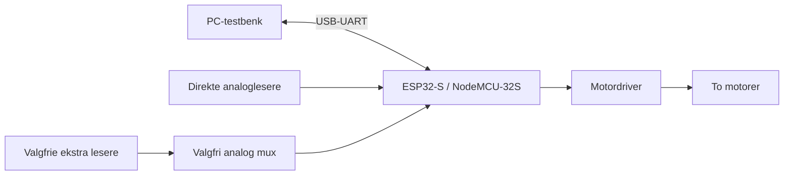

# Linjefølgeren med ett ESP32-kort

To motorer driver roboten, og sensorrekken sitter foran motorene på et 3D-printet chassis. ESP32 leser valgte sensorer og endrer forskjellen mellom hjulenes pådrag for å følge linjen.

## Valg av antall og kort

Den gamle sensoren ga etter gruppens observasjon omtrent to lesere over linjen; den nye omtrent 4–5. Dette er antall fysiske lesere på sensorrekken, ikke et dokumentert presisjonsmål. Når noen utganger utelates, blir antall aktive treff også lavere.

Brikken har 18 ADC-kanaler, men vi velger **12 direkte lesere** som standard på 32S. GPIO37/38 er ikke tilgjengelige kortpinner i profilen, og fire øvrige ADC-pinner har oppstartsfunksjoner. De kan ikke regnes som fritt tilgjengelige uten å undersøke elektronikken.

Utvalget bruker foreløpige indekser som er tettere i midten og glisnere utover. Ytterpunktene dekker bredden. Dette gir verken et kamera eller sikker kunnskap om neste sving. Flere streker i samme målebilde må fortsatt behandles som separate kandidater.

## Pinner og elektriske forutsetninger

| Gruppe | Pinner / regel |
| --- | --- |
| Direkte ADC uten strapping | GPIO4, 13, 14, 25, 26, 27, 32, 33, 34, 35, 36, 39 |
| Blokkerte oppstartspinner | GPIO0, 2, 5, 12, 15 |
| USB-UART | GPIO1 og 3 er reservert |
| Flash | GPIO6–11 er reservert |
| Input-only | GPIO34–39 kan ikke være motor- eller mux-utganger |

Valgfri ADC-strøm-/spenningsmåling må ha en ledig inngang. Alle tolv direkte kanaler opptar kandidatlisten over, så måleutstyr kan kreve endret sensorutvalg eller mux. Encoder på input-only-pinner krever ekstern pullup der det er nødvendig.

GPIO er 3,3 V-logikk og skal ikke få 5 V. Sensoren kan eventuelt forsynes med en kompatibel spenning, eller signalene må tilpasses. Bekreft analog/RC-utgaven før kobling. ADC-attenuasjon gjør ikke inngangene 5 V-tolerante, og måleområdet kan mettes før 3,3 V. Mål faktisk svart/hvitt-kontrast.

Programmet aktiverer ikke radio. ADC2 har en ressurskonflikt med WiFi, så WiFi må ikke bare slås på senere uten ny vurdering.

## Mulighet for multipleksing

Én analog 16:1-mux kan kobles til en ADC-inngang og fire valgpinner. Programmet støtter blanding av direkte og multipleksede kanaler. For å frigjøre valgpinner kan noen nåværende ADC-pinner brukes som digitale utganger i stedet.

Standard antall forblir tolv. For å øke antallet endres `SensorCount` og `SensorInputs`, samt pinnebudsjettet. En mux beholder hver kanals verdi, men gir sekvensiell lesing og stabiliseringstid. Vi beregner ikke gjennomsnitt mellom ulike sensorer.

## Hva som må måles

Elektronikken er ennå ikke klar til fysisk avlesning. Start med å bekrefte modell, forsyning, signalnivåer og GPIO. Deretter måles kontrast, støy, avlesningstid og maksimal kontrolltid. Noter sensorhøyde, lys, underlag og batterispenning sammen med opptakene.

Regulatoren og tidsgrensene er videreført som utgangspunkt. Alle valgte kanaler deltar nå i samme lokale analyse. Større informasjonsgrunnlag kan hjelpe, men løser ikke pendling automatisk. PD, fart og recovery må tunes på roboten.

Den tidligere to-Nano-arkitekturen og dens begrunnelse er bevart på `fase2` og under [historikk](historikk/LINJEFOLGEREN_NANO.md).

Kilder: [Espressif ADC](https://docs.espressif.com/projects/esp-idf/en/v4.4.8/esp32/api-reference/peripherals/adc.html), [NodeMCU-32S](https://docs.platformio.org/en/stable/boards/espressif32/nodemcu-32s.html), [ADC-måleområder](https://docs.espressif.com/projects/arduino-esp32/en/latest/api/adc.html).
