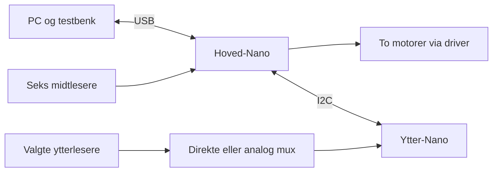

# Slik er linjefølgeren bygget opp

## Formålet

Roboten skal følge en mørk linje på et lysere underlag. To motorer driver hjulene bak sensorrekken. Når hjulene får forskjellig pådrag, svinger roboten. Chassiset er egenkonstruert og 3D-printet.

Første versjon brukte seks lesere. Gruppen observerte omtrent to lesere over linjen. Den nye sensorrekken gir etter foreløpig observasjon 4–5 lesere over samme linje. Det gir flere målepunkter over linjen, men sier ikke alene hvor presist eller raskt roboten vil kjøre.

## Kortene og ansvaret deres

| Del | Ansvar |
| --- | --- |
| Hoved-Nano | Seks lokale midtlesere, kalibrering, regulator, motorer, tidskontroll og PC-kommandoer |
| Ytter-Nano | Valgte ytterlesere, eventuelle analoge multipleksere, komplette sideskann og I2C-svar |
| PC | Starte måleforsøk, tolke rapporter, sette navn på feltene og lagre CSV/JSON |

Hovedkortet er I2C-controller/master. Ytterkortet er perifer/slave. Begge har egne programmer og kjører samtidig; hvert kort har én vanlig hovedløkke. Vi bruker ikke tråder.

## Hva sensoren måler

En reflektansleser sender IR-lys mot underlaget og måler reflektert lys. Det er verken et kamera eller en avstandsmåler for kommende svinger. Svart/hvitt-kontrasten påvirkes blant annet av underlag, høyde, belysning og emitterinnstillinger.

Identifikasjonen er fortsatt foreløpig: `0J11785` matcher QTRX-HD-25, mens oppgitt `irs47j` avviker fra produsentens `irs45j`. A/RC-utgaven må bekreftes. [Pololus spesifikasjoner](https://www.pololu.com/product/4325/specs) sier at PCB-merkingen ikke skiller disse utgavene.

Ytterprogrammet er laget for analogutgaven. Råverdien er da en ADC-verdi 0–1023. Hovedkortets kalibrerte verdi er 0–1000, der høy verdi betyr mørkere funn etter normal kalibrering. Dette er to forskjellige skalaer.

## Hvorfor vi deler sensorrekken

Hovedkortet får direkte avlesning av de seks midtleserne. Det gir et lokalt grunnlag for regulering uten å vente på I2C. Ytterkortet kan bruke seks direkte analoginnganger eller flere valgte kanaler gjennom multipleksere.

Det er ikke nødvendig å bruke alle lesere for å dekke hele bredden. De ytterste aktive leserne bestemmer dekningen. Antall og avstand mellom aktive lesere bestemmer detaljnivået mellom ytterpunktene. For store mellomrom kan skjule en smal linje.

Multipleksing bevarer hver valgt kanal som en egen verdi. Den gir tidsforskjell mellom kanalene og krever stabilisering etter kanalbytte. Dette må skilles fra gjennomsnitt av flere sensorer, som blander romlig informasjon.

## Hvordan roboten styrer

1. Les midtgruppen.
2. Bruk kalibreringen til å gjøre kanalene sammenlignbare.
3. Finn en troverdig gruppe som ser linjen.
4. Beregn posisjonsfeil fra et vektet gjennomsnitt innenfor den valgte gruppen.
5. Bruk P-leddet til å styre mot linjen og D-leddet til å dempe endring i feilen.
6. Begrens og ramp motorutgangene.

Ved kort linjetap kan regulatoren håndtere et gap. Ved lengre tap bruker den historikk til å bremse og søke. Gjenfunn må bekreftes før normal følging gjenopptas. Kvalitet og kjøremodus forklares i [kodeveiledningen](../KODE_FORKLART.md).

PWM er et elektrisk pådrag. Det er ikke en målt fart, kraft eller akselerasjon. Motor, gir, batteri, belastning og underlag påvirker hva roboten faktisk gjør.

## Hva som er ferdig, og hva som gjenstår

Programmet har fast kontrollperiode, tidsmålinger, kalibrering av midtgruppen, PD/recovery, feilstopper, motorforsøk og logging av midt-/ytterdata. Ytterverdiene er foreløpig råverdier som logges; de styrer ikke motorene.

Gjenstående arbeid omfatter korrekt pinneoppsett, sensoridentifikasjon, måling av elektronikken, egen kalibrering for yttergruppen og eventuell sammenslåing av observasjoner. Flere linjefunn skal vurderes som separate kandidater. En linje langt ute kan være riktig fortsettelse eller en annen del av banen; én sensorrekke kan ikke avgjøre dette sikkert uten historikk eller flere observasjoner.

## Før fysisk testing

- Bekreft sensorvariant, kortvariant, driver, forsyning og kabling.
- Bruk konfigurasjonsfilene; eksempelpinner fra minnetesten er ikke robotens koblingsskjema.
- Start med sensor- og timingopptak.
- Noter høyde, underlag, lys og spenning sammen med opptaket.
- Mål svart/hvitt-kontrast, støy, sideskannetid, målealder og tidsfristbrudd.
- Tune regulatoren først når verdier og tidsmålinger er forståelige.

Maskinvare er ennå ikke ferdig til avlesningsforsøk. Programtester og vellykkede bygg bekrefter derfor ikke fysisk sensorrespons eller robotens kjøreegenskaper.
