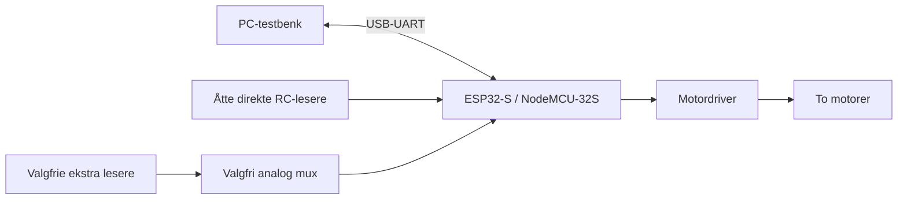

# Linjefølgeren med ett ESP32-kort

To motorer driver roboten, og sensorrekken sitter foran motorene på et 3D-printet chassis. ESP32 leser valgte sensorer og endrer forskjellen mellom hjulenes pådrag for å følge linjen.

## Valg av antall og kort

Den gamle sensoren ga etter gruppens observasjon omtrent to lesere over linjen; den nye omtrent 4–5. Dette er antall fysiske lesere på sensorrekken, ikke et dokumentert presisjonsmål. Når noen utganger utelates, blir antall aktive treff også lavere.

Gjeldende kobling er oppdatert 9. november 2026 for åtte RC-lesere på Pololu QTRX. RC-utgangene lades og utladningstiden måles. GPIO34 er erstattet av GPIO15, siden RC krever pinner som kan være både utgang og inngang.

Dette er oppsettet for programmet som er lastet opp lokalt til roboten. Koden på GitHub kan være eldre; kontroller RC-støtte og `include/board_config.h` før bygging og opplasting.

## Gjeldende kobling

| Funksjon | ESP32 GPIO |
| --- | --- |
| Motor A – AIN1 | 21 |
| Motor A – AIN2 | 22 |
| Motor A – PWMA | 23 |
| Motor B – BIN1 | 17 / TX2 |
| Motor B – BIN2 | 18 |
| Motor B – PWMB | 19 |
| START-knapp | 13 |
| KALIBRER-knapp | 16 / RX2 |
| Kalibreringslys | 2 |
| Felles jord | GND |

Motor A behandles som venstre og B som høyre. Motordriverens STBY holdes HIGH med kompatibelt logikknivå. ESP32, sensor og motordriver skal ha felles GND.

Knappene kobles mellom sin GPIO og GND med intern pullup. Sluppet knapp skal gi HIGH og inntrykt knapp LOW. Holdt knapp ved oppstart må slippes før et nytt trykk godtas. Velg to bein på knappen som bare får kontakt når den trykkes.

LED kobles GPIO2 → 1 kΩ motstand → LED-anode (langt bein), og katode til GND. LED lyser fast under ti sekunders kalibrering og blinker tre ganger ved godkjenning. Ved underkjent eller avbrutt kalibrering slukker den uten bekreftelsesblink. START krever gyldig kalibrering og starter et forsøk på fem sekunder.

## Sensorer fra venstre mot høyre

| Fysisk leser (1–25) | Nullbasert indeks i koden | GPIO |
| --- | --- | --- |
| 1 | 0 | 4 |
| 5 | 4 | 14 |
| 9 | 8 | 25 |
| 12 | 11 | 26 |
| 14 | 13 | 27 |
| 17 | 16 | 32 |
| 21 | 20 | 33 |
| 25 | 24 | 15 |

Flytt ledningen for leser 25 fra GPIO34 til GPIO15 med strømmen av. Kalibrer på nytt etter bytte til RC. GPIO15 er et vurdert unntak fra oppstartspinnesperren; LOW ved reset kan dempe ROM-oppstartsutskriften. GPIO2 brukes med LED-koblingen til GND beskrevet over.

## Pinner og elektriske forutsetninger

| Gruppe | Pinner / regel |
| --- | --- |
| Direkte ADC uten strapping | GPIO4, 13, 14, 25, 26, 27, 32, 33, 34, 35, 36, 39 |
| Oppstartspinner | GPIO0, 5 og 12 unngås; GPIO2 og 15 brukes med koblingen over |
| USB-UART | GPIO1 og 3 er reservert |
| Flash | GPIO6–11 er reservert |
| Input-only | GPIO34–39 kan ikke være motor- eller mux-utganger |

Valgfri ADC-strøm-/spenningsmåling må ha en ledig inngang. RC-kanalene må også støtte utgangsmodus, så GPIO34–39 kan ikke brukes til dem. Encoder på input-only-pinner krever ekstern pullup der det er nødvendig.

GPIO er 3,3 V-logikk og skal ikke få 5 V. Sensoren kan eventuelt forsynes med en kompatibel spenning, eller signalene må tilpasses. Det lokale programmet er satt til RC etter identifikasjon av komponentene på QTRX-kortet. ADC-attenuasjon gjør ikke inngangene 5 V-tolerante, og måleområdet kan mettes før 3,3 V. Mål faktisk svart/hvitt-kontrast.

Programmet aktiverer ikke radio. ADC2 har en ressurskonflikt med WiFi, så WiFi må ikke bare slås på senere uten ny vurdering.

## Mulighet for multipleksing

Én analog 16:1-mux kan kobles til en ADC-inngang og fire valgpinner. Programmet støtter blanding av direkte og multipleksede kanaler. For å frigjøre valgpinner kan noen nåværende ADC-pinner brukes som digitale utganger i stedet.

Mux og tolvkanalsoppsettet er tidligere analoge byggeeksempler. Gjeldende RC-oppsett bruker åtte direkte kanaler. For å øke antallet endres `SensorCount` og `SensorInputs`, samt pinnebudsjettet. En mux beholder hver kanals verdi, men gir sekvensiell lesing og stabiliseringstid. Vi beregner ikke gjennomsnitt mellom ulike sensorer.

## Hva som må måles

RC-avlesning er prøvd og kalibrering har blitt godkjent på roboten. Kontroller forsyning, signalnivåer og GPIO etter omkobling. Deretter måles kontrast, støy, avlesningstid og maksimal kontrolltid. Noter sensorhøyde, lys, underlag og batterispenning sammen med opptakene.

Regulatoren og tidsgrensene er videreført som utgangspunkt. Alle valgte kanaler deltar nå i samme lokale analyse. Større informasjonsgrunnlag kan hjelpe, men løser ikke pendling automatisk. PD, fart og recovery må tunes på roboten.

Den tidligere to-Nano-arkitekturen og dens begrunnelse er bevart på `fase2` og under [historikk](historikk/LINJEFOLGEREN_NANO.md).

Kilder: [Espressif ADC](https://docs.espressif.com/projects/esp-idf/en/v4.4.8/esp32/api-reference/peripherals/adc.html), [NodeMCU-32S](https://docs.platformio.org/en/stable/boards/espressif32/nodemcu-32s.html), [ADC-måleområder](https://docs.espressif.com/projects/arduino-esp32/en/latest/api/adc.html).

Kilder til RC-oppsettet: [Pololu RC](https://www.pololu.com/docs/0J13/2), [GPIO15 ved oppstart](https://docs.espressif.com/projects/esptool/en/latest/esp32/advanced-topics/boot-mode-selection.html).
