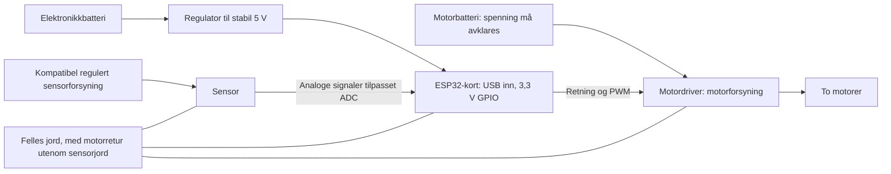

# Nano mot ESP32: sensoravlesning, ytelse og strømforsyning

Dette dokumentet forklarer hvorfor vi bytter fra to klassiske Nano-kort til én ESP32-S / NodeMCU-32S, og hva vi må teste før vi kan si hvor mye bedre roboten blir. Tall fra datablad, beregnede eksempler og fysiske målinger holdes adskilt.

## Hva vi faktisk bygger

Roboten har to motorer, motordriver, et 3D-printet chassis og en Pololu QTRX-sensorrekke foran hjulene. Motor, driver, batteritype og nøyaktig sensorvariant er fortsatt ikke bekreftet.

Sensoren ble omtalt som 26 lesere og merket «irs47j / 0j11785». Dette er foreløpig ikke nok til å fastslå produktet. Koden antar **25 fysiske lesere**, men bruker **12 utvalgte analoge utganger**, med mulighet for analog multiplekser. Antallet og A/RC-utgaven må bekreftes før kabling.

Som et betinget eksempel har [Pololu QTRX-HD-25A](https://www.pololu.com/product/4425) 25 analoge utganger, 4 mm senteravstand og forsyning 2,9–5,5 V. Utgangene kan gå fra 0 V til sensorens forsyningsspenning. Dette er referansedata, ikke bekreftet identifikasjon av vår sensor. RC-utgaven må leses ved å måle utladningstid; dagens ESP32-kode støtter analogvarianten.

## Viktige spesifikasjoner

| Egenskap | Klassisk Nano / ATmega328P, per kort | ESP32 / NodeMCU-32S |
| --- | --- | --- |
| Prosessor | 8-bit AVR, én kjerne | 32-bit Xtensa LX6, to kjerner |
| Klokkefrekvens | 16 MHz | 240 MHz i byggeprofilen |
| SRAM i brikken | 2 KiB | 520 KiB totalt; deles mellom systemets behov |
| RAM-grense i vårt byggeverktøy | 2048 B | 327680 B / 320 KiB; ikke alt er fri heap |
| Flash | 32 KiB, med plass brukt av bootloader | 4 MiB på kortprofilen; app-partisjon 1310720 B |
| ADC-oppløsning | 10 bit: 0–1023 | 12 bit i koden: 0–4095 |
| Analoge kanaler | 8; A4/A5 brukes av I2C i gammel arkitektur | 18 på brikken; 12 direkte valgt i vår kortprofil |
| GPIO-logikk | 5 V | 3,3 V; ikke 5 V-tolerant |
| Kontrollarkitektur hos oss | Hovedkort og ytterkort med I2C | Lokal sensoravlesning og motorstyring på ett kort |

Kilder: [Arduino Nano, spesifikasjoner og ADC](https://store.arduino.cc/products/arduino-nano), [ESP32-datablad](https://documentation.espressif.com/esp32_datasheet_en.html), [PlatformIOs NodeMCU-32S-profil](https://docs.platformio.org/en/stable/boards/espressif32/nodemcu-32s.html).

Nano har altså åtte analoge innganger, selv om seks var tilgjengelige til direkte avlesning når A4/A5 var opptatt av I2C. På ESP32 unngår vi ADC-pinner med oppstartsfunksjoner og pinner som ikke er ført ut på den valgte kortprofilen. Se [pinneoversikten](LINJEFOLGEREN.md).

## Teoretiske ytelsesgevinster

**Mer beregningsmargin.** 240 / 16 = 15 ganger høyere klokkefrekvens per kjerne. Det er ikke en målt hastighetsøkning på 15 ganger: instruksjoner, minnetilgang, ADC og rammeverk er forskjellige. To kjerner betyr heller ikke automatisk dobbel ytelse. Vår kontrollsløyfe er fortsatt sekvensiell i én Arduino-task.

**Mye større minnebudsjett.** Brikkens SRAM-forhold er 520 / 2 = 260. Byggeverktøyets RAM-grense er 160 ganger Nano-grensen, og app-partisjonen er omtrent 43 ganger den gamle grensen på 30720 B. Dette er kapasitetsforhold, ikke fri arbeidsplass under kjøring. Den aktive ESP32-prøveprofilen bruker 295745 B flash og 22472 B statisk RAM, mot hoved-Nanoens tidligere 25364 B og 1342 B. Maskinvareprofilene og rammeverkene er forskjellige. Se [ESP32-målingen](MINNEBRUK.md) og [Nano-målingen](historikk/MINNEBRUK_NANO.md).

**Enklere tilgang til sensorbildet.** I2C-overføring, slaveprotokoll og venting på et annet kort faller bort. Kanalene leses fortsatt etter hverandre, så målebildet er ikke helt samtidig. Flere lesere og mux kan også øke skannetiden. Dessuten hadde den gamle aktive prøveprofilen seks midtlesere og 19 multipleksede ytterlesere: den nye standarden med 12 kanaler er ikke flere kanaler enn dette tidligere oppsettet.

**Samme kontrollfrekvens foreløpig.** Koden bruker fortsatt 8 ms periode, altså 125 reguleringer per sekund, med 6 ms arbeidsgrense. Byttet gir i seg selv ingen økning i reguleringsfrekvens. En eventuell endring til 4 ms ville gitt 250 Hz, men må først underbygges av målt maksimal kjøretid og ny tuning.

Ved 1 m/s flytter roboten seg 8 mm per 8 ms, eller 4 mm per 4 ms. Dette regneeksemplet viser hva kortere periode kan bety; det sier ikke at roboten tåler denne farten eller at 4 ms er verifisert.

## Hvordan linjeavlesningen kan bli bedre

Gruppens observasjon er at den gamle rekken traff omtrent **to lesere over linjen**, mens den nye treffer **fire til fem**. For samme linje og sammenlignbar sensorhøyde antyder dette omtrent 2–2,5 ganger tettere romlig prøvetaking der alle disse kanalene brukes. Det er ingen måling av tilsvarende forbedring i posisjonsnøyaktighet.

Flere aktive treff gir regulatoren mer informasjon om linjens kanter og tyngdepunkt. En liten sidebevegelse kan dermed gi en gradvis endring i beregnet posisjon. Det kan gi roligere PD-regulering, men støy i posisjonen kan også forsterkes av D-leddet. Sensorhøyde, fart, mekanikk og tuning er fortsatt avgjørende.

**Sensorrekken gir den romlige detaljen; ESP32 gjør det enklere å bruke informasjonen.** Tolv utvalgte kanaler garanterer ikke fire–fem aktive treff over hele bredden. Vårt foreløpige utvalg er tettere i midten og glisnere ute. Koden bruker fysisk indeks i posisjonsberegningen, men kan ikke gjenskape verdiene fra utganger som ikke er koblet til. Mux kan hente flere separate kanaler, mot ekstra avlesnings- og stabiliseringstid.

ADC har nominelt fire ganger så mange nivåer: 4096 / 1024 = 4. Det betyr finere talloppløsning, ikke fire ganger mer nøyaktig linjeposisjon. ESP32s ADC har støy og referansevariasjon. Svart/hvitt-kalibrering per kanal er fortsatt nødvendig; den er heller ikke en full korreksjon for ADC-ulinearitet. Koden skalerer etterpå til 0–1000.

Mulige tiltak er ren forsyning, korte signalledninger og flere tidsprøver av samme kanal. Filtrering koster tid og kan forsinke responsen. ADC2 kan ikke brukes som normalt samtidig med WiFi, så radio er avslått i vår løsning. Kilde: [Espressif om ADC, støy, kalibrering og ADC2](https://docs.espressif.com/projects/esp-idf/en/v4.4.8/esp32/api-reference/peripherals/adc.html).

## Strøm: to batterier kan fungere, men bruk regulator

**Ikke bruk et batteri og en seriemotstand som strømforsyning til ESP32.** Motstanden gir spenningsfall etter `V = I × R`. Strømforbruket varierer, og da varierer spenningen kortet får.

Et idealisert eksempel: 57 ohm gir 3,3 V fra 9 V når lasten trekker 100 mA. Ved 20 mA blir spenningen i samme regnestykke 7,86 V. En slik kobling kan skade elektronikken. En spenningsdeler er heller ikke en stabil strømforsyning; den kan eventuelt brukes til signaltilpasning etter dimensjonering.

Et utgangspunkt med separate batterier er:

Diagrammet er et prinsipp, ikke et ferdig koblingsskjema. Med vanlig ikke-isolert driver må jord være felles slik at styresignalene har en referanse. **Batterienes plusspoler skal ikke kobles sammen.** En felles batteripakke med egne regulerte grener er også mulig, men krever tilsvarende kontroll på motorstøy og spenningsfall.

Bruk regulert 5 V via USB som et enkelt startpunkt. Ikke anta at en pinne merket VIN på et ukjent 32S-kort tåler 9 V. Direkte mating av 3V3 krever stabil 3,3 V og avklart kobling mot kortets egen regulator og USB. Unngå samtidig ekstern mating og PC-USB før kortets strømvei er bekreftet.

Espressif anbefaler minst 500 mA tilgjengelig kapasitet til selve ESP32-forsyningen. Dette er dimensjoneringsmargin, ikke konstant forbruk. Legg til sensor og øvrig elektronikk, og velg en regulator som tåler batteriets høyeste og laveste spenning. Buck passer når inngangen alltid er høyere enn utgangen; boost eller buck-boost kan være nødvendig ellers. Kilde: [Espressifs strømforsyningsveiledning](https://docs.espressif.com/projects/esp-hardware-design-guidelines/en/latest/esp32/schematic-checklist.html).

### Spenningen til sensoren og GPIO

5 V på sensorens forsyning kan gi opptil 5 V på en analog utgang. Det skal ikke kobles direkte til ESP32. Dersom vår sensor bekreftes å fungere ved 3,3 V, kan samme logikknivå forenkle koblingen, men regulatorens strømkapasitet må dekke lasten. Driverens innganger må også kunne tolke 3,3 V som høy.

Elektrisk tillatt GPIO-spenning og ADC-måleområde er forskjellige ting: for klassisk ESP32 oppgir Arduino-dokumentasjonen omtrent 150–3100 mV ved 11 dB attenuasjon. En 3,3 V-sensorutgang kan derfor mettes i ADC før den når sin største verdi. Mål svart og hvitt; vurder signaltilpasning hvis nødvendig. Attenuasjon gjør ikke GPIO 5 V-tolerant. Kilder: [Pololus analogutganger](https://www.pololu.com/product/4425), [ESP32 ADC-måleområder](https://docs.espressif.com/projects/arduino-esp32/en/latest/api/adc.html).

### Motorbatteriet

Vi kan ikke godkjenne 9 V til motorene før motorens merkespenning, driverens grenser og start-/stallstrøm er kjent. Motorene forsynes gjennom driveren. Hvis «9 V-batteri» betyr et vanlig firkantet PP3-batteri, er det ofte uegnet til motorlast på grunn av begrenset strømleveranse. Nominell spenning alene forteller ikke om batteriet passer. Kilde: [Pololus batteriråd](https://www.pololu.com/support).

To batterier fjerner ikke all motorstøy. Hold motorledninger unna sensorledninger, før motorstrøm utenom sensorens jordretur, og bruk avkobling etter driverens datablad. For børstemotorer beskriver Pololu blant annet 100 nF keramisk kondensator over motorterminalene og korte, tvinnede ledninger. Kilde: [Pololu om motorstøy](https://www.pololu.com/docs/0J15/9).

## Målingene som avgjør den faktiske gevinsten

| Måling | Enkel framgangsmåte | Hva vi finner ut |
| --- | --- | --- |
| Svart, hvitt og støy per kanal | Logg stillestående sensor over samme flater og høyde, med motor av/på | Kontrast, metning og påvirkning fra motorene |
| Posisjonsfeil og repeterbarhet | Flytt linjen i kjente små sidesteg; gjenta med samme oppsett | Om estimatet følger fysisk posisjon og hvor mye det varierer |
| Skannetid og maksimal kontrolltid | Bruk timing-testen; sammenlikn direkte, mux og valgt filtrering | Om 8 ms-perioden har nok margin |
| Forsyning ved start og brems | Mål 3,3 V og motorforsyning, helst med oscilloskop | Spenningsfall, spiker og reset-årsak |
| Faktisk kjøring | Samme bane, fart, høyde og dokumentert tuning | Linjetap, pendling og rundetid |

Programtester og bygg viser at programmet oppfører seg som forventet under testforutsetningene. Ingen fysisk forbedring i nøyaktighet eller fart er målt ennå. Den forventede fordelen er større beregningsmargin og enklere tilgang til et mer detaljert sensorbilde, forutsatt riktig elektrisk kobling og et godt kanalutvalg.
