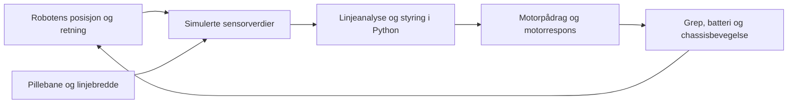

# Simulering av linjefølgeren

Se også [kodeveiledning](../simulator/docs/KODE_FORKLART.md) og [teknologioversikt](../simulator/docs/TEKNOLOGIER.md).

Simulatoren lar gruppen prøve styringen på en virtuell bane og undersøke hvordan sensorplassering, motorrespons, grep og strømforsyning påvirker kjøringen.

## Status og plassering

Simulatorprosjektet ligger under [simulator/](../simulator/) på branchen `codex/simulering`. Der finnes kildekode, konfigurasjoner, firmware-snapshot, tester og detaljert dokumentasjon.

Klon repoet og gå inn i simulatormappen før du kjører kommandoene i denne veiledningen:

```powershell
git clone --branch codex/simulering --single-branch https://github.com/TonzN/linefollower.git
cd linefollower/simulator
python -m venv .venv
```

Styringen er en Python-port av C++-koden fra `LinjeFølger1`, med en referansekopi datert 29. oktober i `firmware/`. `firmware/manifest.json` inneholder SHA-256-kontrollsummer. Porten representerer den eldre Nano-styringen med seks sensorer i standardprofilen. Den senere ESP32-versjonens åtte RC-kanaler, knapper og kalibreringslys må testes på maskinvaren.

## Starte simulatoren

Prosjektet krever Python 3.10 eller nyere. Vinduet bruker Tkinter. Prosjektet har ingen eksterne Python-avhengigheter.

Åpne simulatorens mappe i VS Code. Bruk det eksisterende virtuelle miljøet, eller opprett det:

```powershell
python -m venv .venv
.\.venv\Scripts\python.exe -m testbed
```

Vinduet starter på pause. Bruk **Start / pause** eller mellomrom for å kjøre. **Stopp** låser styringen til stopp mens motorene bremser ned i fysikkmodellen. **Nullstill** starter på nytt med samme startposisjon og tilfeldighetsseed. **Last konfig på nytt** leser JSON-profilen og nullstiller simuleringen.

For kjøring uten vindu med CSV-opptak:

```powershell
.\.venv\Scripts\python.exe -m testbed --headless --seconds 20 --csv runs/test.csv
```

Dette beregner 20 sekunder simulert tid og skriver siste tilstand som JSON i terminalen. En egen profil velges med `--config configs/min_robot.json`.

## Hvordan delene henger sammen



Styringen får sensorverdier, tidspunkt og konfigurasjon. Simulatoren bruker robotens faktiske posisjon til å beregne målinger og logge baneavvik.

Banen består av to rettstrekk og to halvsirkler. Standardoppsettet har mørk linje på lyst underlag. x peker mot høyre, y opp og positiv vinkel mot klokken. Robotposisjonen ligger midt mellom drivhjulene.

Kontrollen oppdateres hvert 8. ms med standardkonstantene. Fysikken beregnes i steg på maksimalt 2 ms og deles ved kontrolltidspunktene. Ny sensorverdi og motorutgang beregnes i samme kontrollrunde. Måletid, beregningstid og variasjon i kontrollperioden er foreløpig idealisert.

## Hva dere kan justere

Rediger `configs/default.json` eller en fullstendig kopi, og last profilen på nytt.

| Seksjon | Eksempler på innstillinger |
| --- | --- |
| `robot` | Masse, hjuldiameter, hjulavstand, treghetsmoment, grep og rullemotstand |
| `sensors` | Antall, bredde, plassering, måleflate, kontrast, støy og utfall |
| `left_motor`, `right_motor` | PWM-dødsone, RPM, akselerasjon, nedbremsing, motorforskjeller, moment og strømanslag |
| `power` | Spenning, indre motstand, batterikapasitet og ladenivå |
| `track` | Rettstrekklengde, svingradius og linjebredde |
| `initial_pose` | Startposisjon og kjøreretning |
| `simulation` | Seed, fysikksteg og visningsintervall |
| `controller` | Regulator- og recoverykonstanter med navn fra C++ |

Geometri oppgis i meter og masse i kilogram. 85 mm skrives `0.085`. Feltnavn med `rpm`, `ms`, `deg`, `v`, `a` og `ohm` angir andre enheter.

Sensorene ligger jevnt fordelt med avstand `span_m / (count - 1)`. Dette må tas med ved sammenligning med dagens robot, der de åtte valgte leserne har ulike mellomrom. Sensorantall endrer sentrum automatisk, mens øvrige feilgrenser og regulatorverdier trenger egen vurdering.

Fysiske standardverdier er eksempelverdier. Gruppen må måle roboten før parameterne kan brukes som grunnlag for ytelsesvurdering.

## Logging og sammenligning

CSV inneholder blant annet posisjon, retning, sensorverdier, linjefeil, målekvalitet, styringsmodus, venstre/høyre motorpådrag, PWM, RPM, spenning, strøm, ladenivå og avstand til linjen.

`time_ms` angir simulert fysikktid. `sensor_time_ms` angir siste kontrollmåling. Bruk samme profil, bane, startposisjon, varighet og seed når to innstillinger sammenlignes.

## Tester og kontrollert status

Kjør fra simulatorens mappe:

```powershell
.\.venv\Scripts\python.exe -m unittest discover -s tests -v
.\.venv\Scripts\python.exe tools/verify_firmware.py
```

Referansetesten krever `g++` på PATH. Den kompilerer C++-snapshoten og sammenligner den med Python-porten på de samme sensorsekvensene. Rapporten lagres i `build/parity_report.json`.

Kontrollert 16. november 2026:

- Kjøring uten vindu i ett simulert sekund fullførte.
- C++-sammenligningen bestod 21 361 kontrollrunder og 36 tilstandsfelt, med modusene T, G, U, B, R, A og S. Kontrollsummene til snapshoten ble verifisert.
- Alle 19 programtester bestod. Batteritesten er rettet til å sammenligne spenningsfallet med forsyningsspenningen i testprofilen. Den tidligere faste grensen på 6 V passet ikke testprofilens 9 V.

Referansesammenligningen gjelder seks sensorer og originalkonstantene. Flyttall sammenlignes med toleranse, siden Python og C++ bruker forskjellig presisjon.

## Modellens begrensninger

Sensorene genererer kalibrerte verdier mellom 0 og 1000 fra dekningen av linjen under en måleflate. RC-utladning, emittertiming, råkalibrering, pinnekoblinger, knappesprett og seriell belastning er utenfor modellen.

Motorene har dødsone og begrenset endring i RPM. Hjulhastighetene brukes til å beregne differensialdrift, med forenklede grenser fra moment og grep. Momentgrensen er skalert med spenning og er ennå ikke knyttet til en full strøm-/PWM-/momentmodell.

Batteriets spenningsfall, strøm og utladning er grove tilnærminger. Kollisjoner og brownout inngår ikke. Standardprofilen har identiske motorer, null sensorstøy og ingen sensorutfall.

Det finnes foreløpig ingen RL-agent, belønningsfunksjon eller treningsgrensesnitt. Neste modellarbeid bør bygge på målt sensorrespons og forsinkelse, motorenes start- og gangterskler, RPM under last, forsyningsspenning og grep.

## Filoversikt i simulatorprosjektet

| Fil eller mappe | Ansvar |
| --- | --- |
| `testbed/controller.py` | Python-port av linjeanalyse og styring |
| `testbed/world.py` | Pillebane og sensorverdier |
| `testbed/physics.py` | Motorrespons, strømforsyning og robotbevegelse |
| `testbed/simulation.py` | Simulert klokke og kobling mellom delene |
| `testbed/viewer.py` | Tkinter-vindu |
| `testbed/config.py` | Profilinnlesing og validering |
| `testbed/__main__.py` | Kommandolinje og CSV-opptak |
| `configs/` | Robotprofiler og firmwarekonstanter |
| `firmware/` | Referansekopi av C++ og kontrollsummer |
| `tests/` | Programtester |
| `tools/verify_firmware.py` | Sammenligning med C++ |
| `docs/KONFIGURASJON.md` | Detaljert beskrivelse av alle modellparametrene |
| `docs/MALEPLAN_OG_MODELL.md` | Måleplan og modelluttrykk for videre arbeid |
| `measurements/` | Maler for fysiske målinger |

Detaljerte veiledninger: [konfigurasjon](../simulator/docs/KONFIGURASJON.md), [måleplan og modelluttrykk](../simulator/docs/MALEPLAN_OG_MODELL.md), [simulatorens README](../simulator/README.md).
