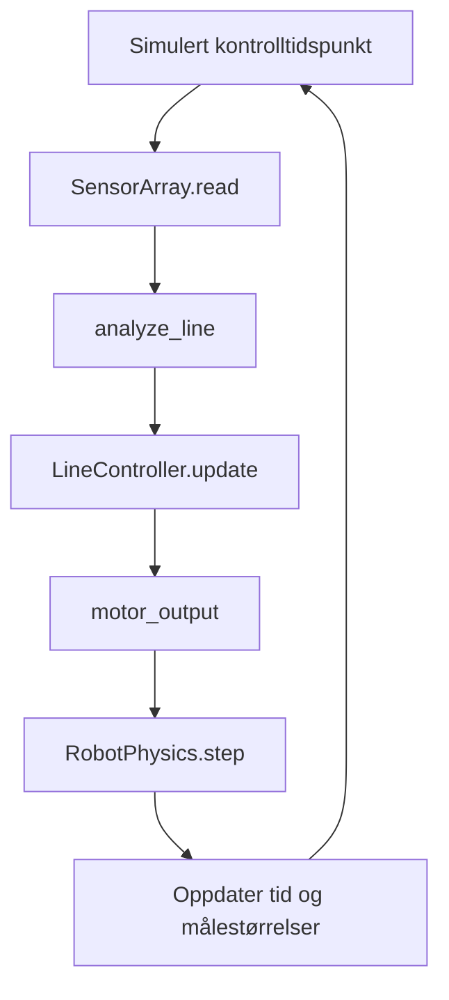

# Kode forklart

Simulatoren beregner hvordan en robot beveger seg langs en mørk linje. Styringen er portert fra C++ til Python. En banemodell lager sensorverdier, og en motor-/fysikkmodell beregner bevegelsen fra motorpådraget.

Les denne veiledningen sammen med [teknologioversikten](TEKNOLOGIER.md), [konfigurasjonen](KONFIGURASJON.md) og [modellens begrensninger](../../docs/SIMULASJON.md).

## Anbefalt leserekkefølge

1. `testbed/__main__.py` viser hvordan programmet startes.
2. `testbed/simulation.py` viser hele kontrollsløyfen.
3. `testbed/world.py` beregner sensorverdiene fra bane og posisjon.
4. `testbed/controller.py` analyserer linjen og bestemmer motorpådraget.
5. `testbed/physics.py` gjør motorpådrag til bevegelse.
6. `testbed/viewer.py` viser resultatet i et vindu.

Alle filstier i teksten er relative til `simulator/`.

## Fra startkommando til simulering

`python -m testbed` kjører `main()` i `testbed/__main__.py`. `argparse` leser valg som `--config`, `--headless`, `--seconds` og `--csv`.

`load_config()` returnerer to objekter. `config` er en ordbok med robot, sensorer, motorer, strømforsyning, bane og tid. `c` er et `SimpleNamespace` med styringskonstanter som kan leses som `c.KP` og `c.CONTROL_PERIOD_MS`.

Med vindu kalles `viewer.launch()`. Uten vindu opprettes `Simulation(config, c)`, og programmet kaller `advance()` til ønsket simulert varighet er nådd. `observation()` gir et målebilde til JSON-utskrift og eventuell CSV.

## Hvordan profilen kontrolleres

`config.py` leser JSON med `pathlib` og `json`. Strukturen sammenlignes med `testbed/config_template.json`. Manglende og ukjente felt avvises, bortsett fra at `controller` tillater et utvalg kjente firmwarekonstanter.

Felt sjekkes for type, endelige tall og gyldige intervaller. Eksempler er positiv masse, sensorantall mellom 2 og 32 og PWM-grenser innenfor 0–255. Styringskonstantene hentes fra `configs/firmware_defaults.json`, med overstyringer fra profilen.

`sensors.count` bestemmer antall lesere. Uten eksplisitt overstyring blir sentrum `(count - 1) * 500`. Dette gir 2500 ved seks sensorer. Andre regulatorgrenser må vurderes når sensorantallet endres.

## En kontrollrunde i Simulation.advance()



`reset()` oppretter fysikk, bane, sensorer og styring på nytt. Seed brukes til repeterbar tilfeldig støy. Tid og motorpådrag begynner på null.

`advance(duration_ms)` går frem til et bestemt tidspunkt. Når `next_control_ms` er nådd, gjøres følgende:

1. Sensorrekken leses ved robotens nåværende posisjon og retning.
2. `analyze_line()` lager en `LineReading` med feil, styrke, gyldighet og kvalitet.
3. `LineController.update()` beregner venstre og høyre motorpådrag.
4. `motor_output()` gjør pådraget om til retning og PWM med firmware-offset.
5. Neste kontrolltidspunkt flyttes frem med kontrollperioden.

Fysikken oppdateres mellom kontrollrundene. Steget begrenses av `physics_step_ms`, neste kontrolltidspunkt og slutten på den forespurte perioden. Standardene gir 8 ms kontrollperiode og maksimalt 2 ms fysikksteg.

Sensorverdiene beholdes mellom kontrollrundene. `sensor_time_ms` angir siste kontrollmåling, mens `time_ms` angir simulert fysikktid. Tegneintervallet styrer hvor ofte vinduet ber om fremdrift.

## Bane og sensorverdier i world.py

`PillTrack` representerer to rette strekk og to halvsirkler. `distance(x, y)` beregner avstanden til banens senterlinje. `points()` lager punktene som brukes til å tegne banen.

`SensorArray.local_positions()` fordeler sensorene jevnt over sensorbredden. Indeks 0 ligger til venstre i robotens kjøreretning. `transform()` roterer og flytter lokale koordinater til banens koordinater.

`read()` legger et rutenett av målepunkter over hver sensors måleflate. Dekning av linjen beregnes med en myk logistisk overgang. Gjennomsnittet omregnes til refleksjonsverdi, justeres med gain og bias, og får eventuell normalfordelt støy eller utfall. Resultatet begrenses til 0–1000.

Styringen mottar disse sensorverdiene. Robotens sanne posisjon brukes av sensor-/fysikkmodellen og loggen.

## Linjeanalyse og styring i controller.py

`LineReading` er en dataklasse for resultatet av én sensoranalyse. `analyze_line()` vurderer signalstyrke og kontrast, finner sammenhengende sensorgrupper og velger en tydelig linjekandidat. Posisjonen beregnes med et vektet gjennomsnitt. Avvik fra sentrum blir `error`.

`LineController` lagrer historikk mellom rundene, blant annet forrige feil, filtrert feilendring, motorpådrag og søkeretning. `update()` håndterer vanlig følging, korte glipper, tvetydige målinger, linjetap, søking og innretting ved gjenfunn.

Ved vanlig følging består svingkorreksjonen av P-bidrag fra feil og D-bidrag fra filtrert feilendring. Venstre og høyre mål bygges rundt et grunnpådrag. Ramper og grenser bestemmer hvor raskt målene kan endres.

| Modus fra `mode()` | Betydning |
| --- | --- |
| T | Vanlig følging |
| G | Kort glipp |
| U | Tvetydig måling |
| B | Nedbremsing før søk |
| R | Søking etter linjen |
| A | Innretting ved gjenfunn |
| S | Stopp |
| C | Kandidatmodus finnes i porten, men inngår ikke i den påkrevde referansedekningen |

`elapsed()` beregner tidsforskjeller med 32-bits omslag som i firmware. Python bruker større flyttallspresisjon enn C++-referansen, så sammenligningstesten bruker toleranser.

## Fra PWM til bevegelse i physics.py

`motor_output(command, offset)` følger motorlogikken i den eldre firmwaren. Retning bestemmes av fortegnet etter heltallskonvertering, og PWM beregnes fra absoluttverdien av kommando pluss offset. Motor A er høyre og B venstre i denne snapshoten.

`Motor.update()` beregner mål-RPM fra PWM-dødsone, minimum/maksimum RPM, spenning og motorens styrkefaktor. RPM endres med akselerasjons- eller nedbremsingsgrensen. Ved reversering går den først mot null. Strømmen er et forenklet anslag.

`RobotPhysics.step()` oppdaterer spenning og motorer, omregner RPM til hjulhastigheter og beregner ønsket fremdrift og rotasjon:

```text
hjulhastighet = RPM * pi * hjuldiameter / 60
fremdrift = (venstre hjulhastighet + høyre hjulhastighet) / 2
rotasjon = (høyre hjulhastighet - venstre hjulhastighet) / hjulavstand
```

Grep, moment, masse, rullemotstand og treghetsmoment begrenser chassisets respons. Til slutt oppdateres posisjon og retning. Moment- og strømanslagene er forenklede, og må vurderes mot fysiske målinger.

## Vindu, stopp og logging

`viewer.py` bruker Tkinter Canvas til bane, robot, sensorer og spor. `root.after()` planlegger neste oppdatering i samme hendelsesløkke. Statusfeltet viser blant annet tid, modus, sensorverdier og RPM.

Pause stanser fremdriften i simulert tid. `Simulation.stop()` låser styringen til stopp og setter motorutgangene til null. Ved videre tidssteg bremser motorene ned i fysikkmodellen. Reset oppretter ny starttilstand.

`Simulation.observation()` samler tilstanden i en ordbok. `csv.DictWriter` skriver den ved kjøring med `--csv`. Loggen inneholder både styringens sensorinformasjon og fysisk modelltilstand for analyse.

## Hva testene kontrollerer

`tests/test_testbed.py` tester konfigurasjon, sensorrekkefølge, styringsmodi, tidsomslag, repeterbarhet, grep, reversering, strømforsyning og stopp.

`tools/verify_firmware.py` kontrollerer snapshotens SHA-256-verdier, bygger en C++-referanse med en liten Arduino-stubb og sender samme sensorsekvenser til C++ og Python. Resultatene sammenlignes for målinger, moduser og 36 tilstandsfelt.

Kjør fra `simulator/`:

```powershell
python -m unittest discover -s tests -v
python tools/verify_firmware.py
```

Referansetesten har 21 361 kontrollrunder med seks sensorer og originalkonstantene. Fysikkens samsvar med den virkelige roboten krever egne målinger.
